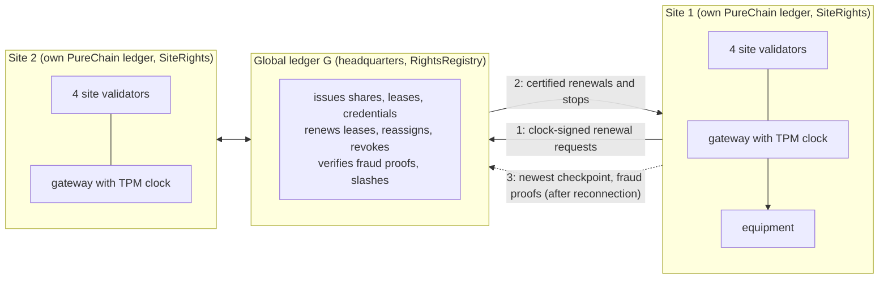

# OffGrant

**An accountable offline blockchain for industrial IoT.**

Industrial sites (substations, mines, ships, offshore platforms) lose their network uplink for seconds to days.
When that happens, a blockchain that spans all sites cannot serve the cut-off site, and a separate ledger per site
lets two sites use the same exclusive right at the same time. OffGrant lets a cut-off site **keep working safely
on rights it received in advance**, and makes every rule violation it records **provable against the validators
who signed it**.

This repository contains everything needed to check and reproduce the work: the smart contracts, the formal
(TLA+) models, a discrete-event simulator, and the end-to-end experiments on PureChain networks.

---

## Contents

- [The problem in one example](#the-problem-in-one-example)
- [How OffGrant works](#how-offgrant-works)
- [Repository map](#repository-map)
- [Quick start](#quick-start)
- [Results at a glance](#results-at-a-glance)
- [Documentation](#documentation)
- [Glossary](#glossary)
- [License](#license)

---

## The problem in one example

Two substations share a feeder. Only one of them may hold the **switching window** on it at a time. Headquarters
decides who holds it. Substation 1 holds it when its satellite uplink drops. While it is cut off, headquarters
decides to give the window to substation 2.

- If substation 1 stops everything while cut off, work at the site halts.
- If substation 1 keeps acting on its old belief, both substations may switch the same line.

OffGrant lets substation 1 keep its rights for a bounded time, tells headquarters exactly how long to wait before
handing the window over, and guarantees that the two never overlap, even if the site's clock is 15% off, it loses
power, or messages arrive very late.

## How OffGrant works



1. **Rights are issued in advance.** While connected, headquarters (the global ledger `G`) gives each site
   *shares* of countable resources (e.g. 40 of 100 spare parts), *leases* on exclusive objects (permits, crane
   slots, isolation points) and *credential leases* (which operators may act there).
2. **Each site runs its own ledger.** A cut-off site keeps a working PureChain (Clique) ledger. Its `SiteRights`
   contract accepts an operation only if the site's rights allow it.
3. **Leases count on the site's trusted clock.** A lease lasts `A = D(1+ρ)` milliseconds on the site's TPM 2.0
   clock, counted from the moment the site **sent** its renewal request. The lease is bound to the clock's
   *epoch*, so a power loss ends it. Headquarters waits `W = ⌈A/(1−ρ)⌉ + 2ε_G` after the last renewal before
   giving the object to another site. This is the smallest safe wait (the classical lease bound), and it needs no
   assumption about message delays.
4. **A grant takes effect only when the gateway executes it.** The site's ledger first makes the grant final.
   The gateway then reads its clock again and executes only if the hold still fits inside the lease. Otherwise
   the grant *lapses*. A *bounded hold* (a switching window) must end inside the lease. An *open hold* (a
   lockout) lasts until it is released, and its object is never moved by expiry.
5. **Checkpoints make the site accountable.** Site validators sign checkpoints of their ledger. Each checkpoint
   commits the operations, the running totals and a closing time attested by the TPM. Headquarters renews a site
   only if its checkpoints are anchored, so a site that hides its history loses its rights. After an outage of
   any length, one transaction anchors the newest checkpoint.
6. **Violations are provable.** Anyone can submit a fraud proof to `G` (overspending, understated totals,
   over-use, use after release, forks). Each proof costs constant gas. It slashes exactly the validators whose
   signatures prove the violation, never an honest one. A site with more than `f` slashed validators loses all
   rights.

The guarantees and their exact conditions are in [docs/CONCEPTS.md](docs/CONCEPTS.md).

## Repository map

| Path | What it is | Guide |
|---|---|---|
| `contracts/src/` | Solidity contracts: `RightsRegistry` (global ledger), `SiteRights` (site ledger), `OffLib` (shared encodings) | [docs/CONTRACTS.md](docs/CONTRACTS.md) |
| `contracts/test/` | Foundry tests, one or more per property and per attack | [docs/CONTRACTS.md](docs/CONTRACTS.md#tests) |
| `formal/` | TLA+ models of the lease bound (`LeaseV3.tla`) and of site-ledger accountability (`RightsV3.tla`), TLC configurations, outputs in `formal/results/` | [docs/FORMAL.md](docs/FORMAL.md) |
| `prototype/` | `offsim.py` (30-day simulator with baselines and ablations), `analyze.py` (summaries), `figs.py` (figures) | [docs/SIMULATOR.md](docs/SIMULATOR.md) |
| `experiments/offgrant/` | End-to-end runs on real PureChain networks (`e2e.py`, `e2e_analyze.py`, shared helpers in `chain.py`) and the public-testnet run (`pubtest.py`) | [docs/EXPERIMENTS.md](docs/EXPERIMENTS.md) |
| `experiments/span_demo.py` | Shows the problem: one chain stretched over three sites halts the cut-off site | [docs/EXPERIMENTS.md](docs/EXPERIMENTS.md#1-the-problem-one-chain-across-sites) |
| `experiments/results/` | Every result file (JSON, logs, summaries). Earlier versions are kept for comparison | [docs/EXPERIMENTS.md](docs/EXPERIMENTS.md#result-files) |
| `testbed/purechain/` | Docker image of the official PureChain v1.0.1 node and a generator of local networks (`mknet.py`) | [docs/EXPERIMENTS.md](docs/EXPERIMENTS.md#testbed) |

## Quick start

**Run the contract tests (needs only Docker):**

```sh
git clone https://github.com/hamzalabwork-sudo/OffGrant.git && cd OffGrant/contracts
docker run --rm -v "$PWD:/work" -w /work --entrypoint forge ghcr.io/foundry-rs/foundry:v1.8.4 install foundry-rs/forge-std --no-git
# foundry.toml points to a local compiler; let Foundry fetch solc 0.8.30 instead:
sed -i 's|^solc = .*|solc = "0.8.30"|' foundry.toml
docker run --rm -v "$PWD:/work" -w /work --entrypoint forge ghcr.io/foundry-rs/foundry:v1.8.4 test
```

**Run a short simulation (needs Python 3.10+):**

```sh
pip install -r requirements.txt
python prototype/offsim.py --quick --workers 1 --out /tmp/quick.jsonl
python prototype/analyze.py /tmp/quick.jsonl
```

The model checking, the full simulation grid and the PureChain experiments are described step by step in
[docs/EXPERIMENTS.md](docs/EXPERIMENTS.md) and [docs/FORMAL.md](docs/FORMAL.md).

## Results at a glance

From the end-to-end run on PureChain (`experiments/results/e2e_v4_summary.json`). Site 1's clock ran 15% slow,
the lease was time-compressed to `D = 60 s`, and site 1's uplink was cut for 150 s:

| What was checked | Outcome |
|---|---|
| Old holder never acts after its object moves | P11: last effect ended at 122.3 s, object moved at 130.9 s; P21 and L11 moved only after every hold ended |
| A grant that would end too late | Lapsed at the gateway instead of taking effect |
| Lockout object (open hold) | Refused by expiry (`HoldMayBeOpen`); moved only after release and acknowledgement |
| Catch-up after the 150 s outage | One anchor transaction, 2.5 s after reconnection, covering 25 checkpoints |
| Ten kinds of injected violation | Each slashed exactly the expected validators (3, or 2 where only some signers are provably faulty) |
| Forged checkpoint close | Rejected (`BadClockSig`) |
| Proof attempts against honest operations | 282 attempts, none slashed anyone |

All 41 contract tests pass (`experiments/results/forge_test_v3.log`).

## Documentation

| Guide | Read it to learn |
|---|---|
| [docs/CONCEPTS.md](docs/CONCEPTS.md) | The problem, the system model, every protocol rule, and what is and is not guaranteed |
| [docs/CONTRACTS.md](docs/CONTRACTS.md) | The contract functions, data formats, signatures, errors and tests |
| [docs/FORMAL.md](docs/FORMAL.md) | The TLA+ models, what each configuration checks and how to run TLC |
| [docs/SIMULATOR.md](docs/SIMULATOR.md) | The simulator's model, protocols, metrics and output fields |
| [docs/EXPERIMENTS.md](docs/EXPERIMENTS.md) | How to build the PureChain testbed and reproduce every experiment |

## Glossary

| Term | Meaning |
|---|---|
| **G** | The global ledger run by headquarters. It issues rights and judges fraud proofs |
| **Site ledger** | A PureChain (Clique proof-of-authority) chain run by one site's validators. It keeps working while the site is cut off |
| **Right** | A share of a resource, a lease on an exclusive object, or a credential lease |
| **Lease, allowance `A`** | How long, on the site clock, a site may grant an object after sending its last answered renewal request |
| **Offline tolerance `D`** | The real time a cut-off site can keep granting. `A = D(1+ρ)` |
| **Drift `ρ`** | Maximum clock-rate error. TPM 2.0 allows 15% (`ρ = 0.15`) |
| **Wait `W`** | How long `G` waits after the last renewal before giving an object to another site |
| **Epoch** | The TPM's reset/restart counter. It changes on power loss and ends every lease |
| **Hold** | The period a grant is in effect: bounded (has an end) or open (until released) |
| **Gateway** | The site component that holds the TPM and executes grants on equipment |
| **Checkpoint** | A signed summary of a stretch of the site ledger: operations, running totals, TPM-attested closing time |
| **Anchor** | Recording a site's checkpoint on `G` |
| **Fast path** | Moving an object at once when its holder is connected and acknowledges the stop |
| **Slashing** | Forfeiting a validator's collateral and excluding it from quorums after a fraud proof |

## License

Released under the [MIT License](LICENSE). You may use, modify and redistribute the code, including
commercially, as long as the copyright notice is kept.
