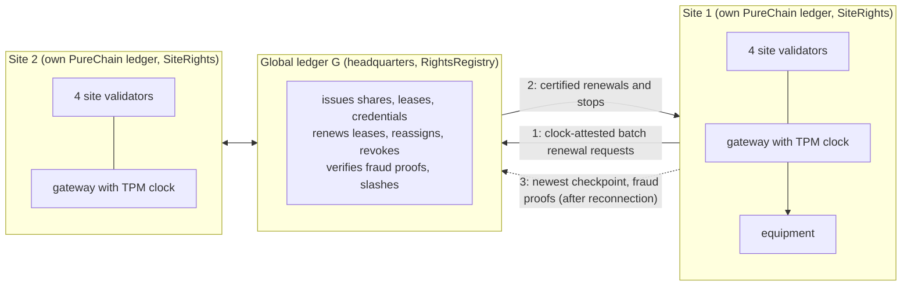

# OffGrant

**An accountable offline blockchain for industrial IoT.**

Industrial sites (substations, mines, ships, offshore platforms) lose their network uplink for seconds to days.
When that happens, a blockchain that spans all sites cannot serve the cut-off site, and a separate ledger per site
lets two sites use the same exclusive right at the same time. OffGrant lets a cut-off site **keep working safely
on rights it received in advance**, and makes every rule violation it records **provable against the validators
who signed it**.

This repository contains everything needed to check and reproduce the work: the smart contracts, the formal
(TLA+) models, a discrete-event simulator, and the end-to-end experiments on PureChain networks.

---

## Contents

- [The problem in one example](#the-problem-in-one-example)
- [How OffGrant works](#how-offgrant-works)
- [Repository map](#repository-map)
- [Quick start](#quick-start)
- [Results at a glance](#results-at-a-glance)
- [Documentation](#documentation)
- [Glossary](#glossary)
- [License](#license)

---

## The problem in one example

Two substations share a feeder. Only one of them may hold the **switching window** on it at a time. Headquarters
decides who holds it. Substation 1 holds it when its satellite uplink drops. While it is cut off, headquarters
decides to give the window to substation 2.

- If substation 1 stops everything while cut off, work at the site halts.
- If substation 1 keeps acting on its old belief, both substations may switch the same line.

OffGrant lets substation 1 keep its rights for a bounded time, tells headquarters exactly how long to wait before
handing the window over, and guarantees that the two never overlap, even if the site's clock is 15% off, it loses
power, or messages arrive very late.

## How OffGrant works



1. **Rights are issued in advance.** While connected, headquarters (the global ledger `G`) gives each site
   *shares* of countable resources (e.g. 40 of 100 spare parts), *leases* on exclusive objects (permits, crane
   slots, isolation points) and *credential leases* (which operators may act there).
2. **Each site runs its own ledger.** A cut-off site keeps a working PureChain (Clique) ledger. Its `SiteRights`
   contract accepts an operation only if the site's rights allow it. Every operation that uses a right carries
   the TPM's attestation of its whole content, and their clock readings strictly increase, so an attestation
   cannot be replayed, reordered or reused.
3. **Leases count on the site's trusted clock.** A lease lasts `A = D(1+ρ)` milliseconds on the site's TPM 2.0
   clock, counted from the moment the site **sent** its renewal request (one request renews all the site's
   objects). The lease is bound to the clock's *epoch*, so a power loss ends it. Headquarters waits
   `W = ⌈A/(1−ρ)⌉ + 2ε_G` after the last renewal before giving the object to another site. This is the smallest
   safe wait (the classical lease bound), and it needs no assumption about message delays.
4. **A grant takes effect only when the gateway executes it.** The site's ledger first makes the grant final.
   The gateway then reads its clock again and executes only if the hold still fits inside the lease. Otherwise
   the grant *lapses*. A *bounded hold* (a switching window) must end inside the lease. An *open hold* (a
   lockout) lasts until it is released, and its object is never moved by expiry. Several crews may each hold
   their own lock on one object; a release names the lock it ends.
5. **Checkpoints make the site accountable.** Site validators sign checkpoints of their ledger. Each checkpoint
   commits the operations, the site's state (running totals, share versions, clock), every earlier checkpoint
   (in a history accumulator) and a closing time attested by the TPM. Headquarters renews a site only if its
   checkpoints are anchored, so a site that hides its history loses its rights. After an outage of any length,
   one transaction anchors the newest checkpoint.
6. **Violations are provable.** Anyone can submit one of nine fraud proofs to `G` (overspending, forged or
   reordered operations, over-use, understated or regressed state, use after acknowledgement, forks). A proof's
   cost does not depend on the length of the site's history. It slashes exactly the validators whose signatures
   prove the violation, never an honest one. A site with more than `f` slashed validators loses all rights.

The guarantees and their exact conditions are in [docs/CONCEPTS.md](docs/CONCEPTS.md).

## Repository map

| Path | What it is | Guide |
|---|---|---|
| `contracts/src/` | Solidity contracts: `RightsRegistry` (global ledger), `SiteRights` (site ledger), `OffLib` (shared encodings) | [docs/CONTRACTS.md](docs/CONTRACTS.md) |
| `contracts/test/` | Foundry tests, one or more per property and per attack | [docs/CONTRACTS.md](docs/CONTRACTS.md#tests) |
| `formal/` | TLA+ models of the lease bound (`LeaseV3.tla`) and of site-ledger accountability (`RightsV3.tla`), TLC configurations, outputs in `formal/results/` | [docs/FORMAL.md](docs/FORMAL.md) |
| `prototype/` | `offsim.py` (30-day simulator with baselines and ablations), `analyze.py` (summaries), `figs.py` (figures) | [docs/SIMULATOR.md](docs/SIMULATOR.md) |
| `experiments/offgrant/` | End-to-end runs on real PureChain networks (`e2e.py`, `e2e_analyze.py`, shared helpers in `chain.py`), the public-testnet run (`pubtest.py`), the reconnection storm (`storm.py`) and the repeated runs (`run_e2e_v6.sh`) | [docs/EXPERIMENTS.md](docs/EXPERIMENTS.md) |
| `experiments/span_demo.py` | Shows the problem: one chain stretched over three sites halts the cut-off site | [docs/EXPERIMENTS.md](docs/EXPERIMENTS.md#1-the-problem-one-chain-across-sites) |
| `experiments/results/` | Every result file (JSON, logs, summaries). Earlier versions are kept for comparison | [docs/EXPERIMENTS.md](docs/EXPERIMENTS.md#result-files) |
| `testbed/purechain/` | Docker image of the official PureChain v1.0.1 node and a generator of local networks (`mknet.py`) | [docs/EXPERIMENTS.md](docs/EXPERIMENTS.md#testbed) |

## Quick start

**Run the contract tests (needs only Docker):**

```sh
git clone https://github.com/hamzalabwork-sudo/OffGrant.git && cd OffGrant/contracts
docker run --rm -v "$PWD:/work" -w /work --entrypoint forge ghcr.io/foundry-rs/foundry:v1.8.4 install foundry-rs/forge-std --no-git
# foundry.toml points to a local compiler; let Foundry fetch solc 0.8.30 instead:
sed -i 's|^solc = .*|solc = "0.8.30"|' foundry.toml
docker run --rm -v "$PWD:/work" -w /work --entrypoint forge ghcr.io/foundry-rs/foundry:v1.8.4 test
```

The contracts compile through the IR pipeline, so the first run takes about a minute.

**Run a short simulation (needs Python 3.10+):**

```sh
pip install -r requirements.txt
python prototype/offsim.py --quick --workers 1 --out /tmp/quick.jsonl
python prototype/analyze.py /tmp/quick.jsonl
```

The model checking, the full simulation grid and the PureChain experiments are described step by step in
[docs/EXPERIMENTS.md](docs/EXPERIMENTS.md) and [docs/FORMAL.md](docs/FORMAL.md).

## Results at a glance

All results are for contract version 6.

**End to end on PureChain** (`experiments/results/e2e_v6_r{1,2,3}_summary.json`, `e2e_v6flap_r{1,2,3}_summary.json`,
aggregated in `e2e_v6_agg.json` and `e2e_v6flap_agg.json`). Three runs with a clean 150 s cut of site 1's uplink
and three with a flapping, lossy uplink instead. Site 1's clock ran 15% slow, site 2's 5% fast, and the lease was
time-compressed to `D = 60 s` (`A = 69 s`, `W = 86 s`). Values are minimum / median / maximum over three runs, or
totals:

| What was checked | Clean cut | Flapping uplink |
|---|---|---|
| Effects of an old holder that ended after its object moved | 0 | 0 |
| Margin from the old holder's last effect to the move: P11 (slow path) | 42 / 47 / 47 s | 8.6 / 9.0 / 29 s |
| Margin: L11 (lock, by acknowledgement) | 107 / 112 / 115 s | 91 / 92 / 111 s |
| Margin: P21 (by acknowledgement) | 55 / 57 / 102 s | 30 / 49 / 56 s |
| Margin: P22 (acknowledged after site 2 lost power) | 43 / 52 / 54 s | 49 / 54 / 55 s |
| Renewal, send to site (median per run) | 5.7 / 5.9 / 5.9 s | 5.9 / 5.9 / 6.0 s |
| Grant to effect (median per run) | 9.3 / 9.7 / 9.7 s | 9.4 / 9.5 / 10.1 s |
| Catch-up anchor after reconnection | 2.3 / 3.2 / 3.3 s, covering 23-25 checkpoints | 2.5 / 9.6 / 12 s, covering 13-24 |
| Anchors logged by the relayer / found on chain | 182 / 182 | 180 / 180 |
| Lock requests / recorded (the rest refused by the gateway: allowance expired, no renewal, earlier epoch, acknowledged) | 31 / 4 | 32 / 5 |
| Release attempts by another crew | all refused | all refused |
| 22 kinds of injected violation / 5 forgeries | all slashed / all rejected, in every run | same |
| Proof attempts against honest data | 4,001, all `NotAViolation` | 4,075, all `NotAViolation` |

`G` refused to move the lockout L11 by expiry (`HoldMayBeOpen`); it moved only after its crew released it and the
site acknowledged. After site 2 lost power, the gateway carried the P22 holds of the old epoch and waited out their
remaining time, scaled by `(1+ρ)/(1−ρ)`, before acknowledging. All four validators agreed on every checkpoint, and
none had to retry or halt.

*Send versus receipt.* In an earlier batch of three flapping runs (`experiments/results/superseded_v6_prefix/`,
whose harness differed only in a fix to the scripted P22 grant), a renewal sent just before a cut arrived 8.5 s
and 8.8 s late in two runs. Counted from the send, the allowance ended 8.4 s and 8.7 s before `G` moved P11;
counted from the delayed receipt, it would have run past the move.

**Public PureChain testnet** (`experiments/results/pubtest_v6.json`, registry
`0xeCD9df26d3D9b59f90E5c89C2DE7C085DF210c33`). Batch renewals confirmed in 1.95 s median (at most 2.5 s over 24)
at 73,696 gas for one object; a batch of 8 objects cost 393,233 gas. Anchors of 24 operations cost 147,869 gas.
All 313 proof attempts against honest data reverted with `NotAViolation`, and two real fraud proofs slashed 3 and
2 validators.

**Reconnection storm** (`experiments/results/storm_v6.json`). 10 to 100 sites, each with 3 objects and 600 checkpoints sealed during a
simulated one-hour outage, reconnected to the local `G` at once. With 100 sites, every site held a renewal again
within 9.7 s (median 8.4 s, against 4.3 s for 10 sites). The storm spanned 8 blocks of at most 8.9M gas, under a
third of the 30M block limit; each site needed one anchor (148k gas) and one batch renewal (197k gas).

**Simulation** (`experiments/results/offsim_v6_summary.txt`, 720 runs of 30 days). The simulator enforces each
protocol's rules, so OffGrant's zero conflicts hold by construction; what it measures is how the alternatives fail
and what OffGrant costs. The merging baselines had authority overlaps in 569 runs and double use in 514. Each
ablation that drops one rule fails: without the hold-end rule (`nohold`) 306 runs had overlaps, without drift
handling (`nodrift`) 143, without epochs (`noepoch`) 77, and without the fresh check (`nofresh`) 44. Counting from
receipt (`receipt`) left rights beyond the move in 109 runs, and a single `ε_G` of slack (`eps1`) in 12. Waiting
for release left objects with unreachable holders for up to 216 h; OffGrant never exceeded `W`.

**Contracts.** All 61 Foundry tests pass (`experiments/results/forge_test_v6.log`), including regression tests
for every exploit of v4 and v5 found in review.

**Model checking** ([docs/FORMAL.md](docs/FORMAL.md)). The full lease protocol satisfies `Safe` and `Tolerance` in
all 85.3 million states of a small instance; on a larger instance every configuration that drops one rule yields a
counterexample of 7-17 states. The accountability model holds with zero, one, three and four faulty validators
and with two faulty validators shows no violation in the 288 million states explored so far.

## Documentation

| Guide | Read it to learn |
|---|---|
| [docs/CONCEPTS.md](docs/CONCEPTS.md) | The problem, the system model, every protocol rule, and what is and is not guaranteed |
| [docs/CONTRACTS.md](docs/CONTRACTS.md) | The contract functions, data formats, signatures, errors and tests |
| [docs/FORMAL.md](docs/FORMAL.md) | The TLA+ models, what each configuration checks and how to run TLC |
| [docs/SIMULATOR.md](docs/SIMULATOR.md) | The simulator's model, protocols, metrics and output fields |
| [docs/EXPERIMENTS.md](docs/EXPERIMENTS.md) | How to build the PureChain testbed and reproduce every experiment |

## Glossary

| Term | Meaning |
|---|---|
| **G** | The global ledger run by headquarters. It issues rights and judges fraud proofs |
| **Site ledger** | A PureChain (Clique proof-of-authority) chain run by one site's validators. It keeps working while the site is cut off |
| **Right** | A share of a resource, a lease on an exclusive object, or a credential lease |
| **Lease, allowance `A`** | How long, on the site clock, a site may grant an object after sending its last answered renewal request |
| **Offline tolerance `D`** | The real time a cut-off site can keep granting. `A = D(1+ρ)` |
| **Drift `ρ`** | Maximum clock-rate error. TPM 2.0 allows 15% (`ρ = 0.15`) |
| **Wait `W`** | How long `G` waits after the last renewal before giving an object to another site |
| **Epoch** | The TPM's reset/restart counter. It changes on power loss and ends every lease |
| **Hold** | The period a grant is in effect: bounded (has an end) or open (until released) |
| **Gateway** | The site component that holds the TPM and executes grants on equipment |
| **Attested operation** | A consumption, grant, release or acknowledgement signed by the site's TPM over its whole content. Readings of attested operations strictly increase |
| **Checkpoint** | A signed summary of a stretch of the site ledger: operations, state, history accumulator, TPM-attested closing time |
| **History accumulator** | A fixed-depth Merkle tree of all earlier checkpoints of a site, committed in each checkpoint |
| **Anchor** | Recording a site's checkpoint on `G` |
| **Fast path** | Moving an object at once when its holder is connected and records an acknowledgement (`ACK` operation) of the stop |
| **Slashing** | Forfeiting a validator's collateral and excluding it from quorums after a fraud proof |

## License

Released under the [MIT License](LICENSE). You may use, modify and redistribute the code, including
commercially, as long as the copyright notice is kept.
